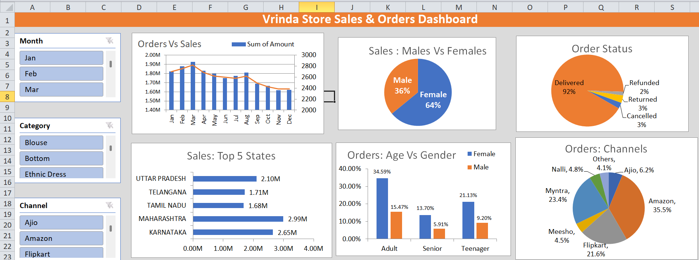

# Vrinda Store Sales & Customer Analytics Dashboard

## Project Overview

An interactive retail sales and customer analytics dashboard developed using Microsoft Excel to analyze sales performance, customer behavior, order status, geographic performance, and sales channels.

## Objective

To analyze retail sales and order data and identify key customer segments, high-performing regions, product categories, and major sales channels that can support targeted sales and marketing decisions.

## Tools & Techniques

- Microsoft Excel
- Pivot Tables
- Pivot Charts
- Slicers
- Data Visualization
- Business & Customer Segmentation Analysis

## Analysis Performed

- Monthly sales and order trends
- Sales by gender
- Orders by age group and gender
- Top-performing states
- Order status distribution
- Sales/order contribution by channel
- Category performance
- Interactive filtering using Month, Category, and Channel slicers

## Key Insights

- Female customers contribute a larger share of purchases.
- Adults represent a major customer segment.
- Maharashtra, Karnataka, and Uttar Pradesh are among the leading states.
- Amazon, Flipkart, and Myntra are major contributing channels.
- Customer and channel-level patterns can be used to support targeted marketing and sales strategies.

## Dashboard Preview

